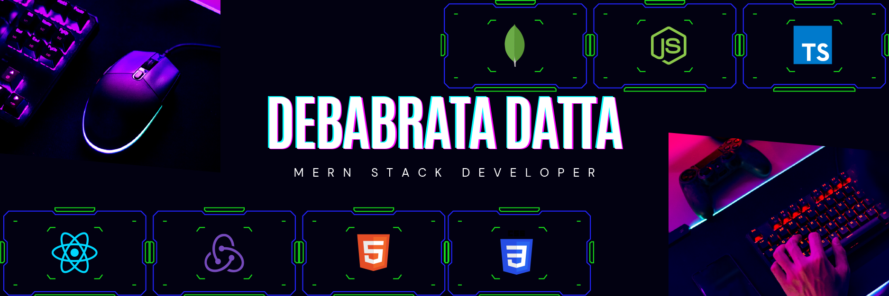

# 👋 Hi, I'm Debabrata Datta
**AI Developer @ erbrains** | Building production LLM applications & AI systems

## 🔭 Current Focus
- **Applied AI at erbrains:** LLM application development, RAG systems, AI agent workflows
- **Stack:** Python, LangChain, LlamaIndex, FastAPI, Vector Databases (Pinecone/Weaviate/pgvector)
- **Transitioning from:** 3+ years production Frontend Engineering → Applied AI

## 🏗️ Engineering Background (3+ years)
- **Frontend Lead capabilities:** React, Next.js, TypeScript, React Query, Redux, RxJS
- **Architected & shipped at scale:**
  - Multi-tenant healthcare platform (5+ tenants, isolated deployments, RBAC)
  - Real-time EV fleet tracking (1,000+ vehicles, OpenLayers, marker clustering)
  - Server-side PDF generation with custom pagination & encryption
  - Device-specific responsive systems (component-level, not just CSS)
- **React Query expertise:** True optimistic updates w/ rollback, typed wrapper layer, centralized query-key factory, cursor/page infinite scrolling

## 🚀 Featured Projects (Engineering Depth)
| Project | Stack | Highlights |
|---------|-------|------------|
| **[Social Connect](https://github.com/ImDebabrata/social-connect-next)** | Next.js 15, TypeScript, Prisma, PostgreSQL, Socket.io, Docker | Full-stack social platform. **True optimistic updates w/ rollback** (React Query), cursor-based infinite feeds, real-time messaging via separate Socket.io microservice |
| **[Highlight Saver Extension](https://github.com/ImDebabrata/highlight-saver-extension)** | TypeScript, Chrome Ext MV3, esbuild, Gemini API | Shadow-DOM UI injection, local-first storage, on-demand AI summaries |

> **Note:** AI projects from my work at **erbrains** are proprietary. This profile demonstrates the **engineering rigor** I bring to AI development — clean architecture, typed systems, caching strategies, and production-grade delivery.

## 🛠️ Tech Stack
**AI/ML (Current):** Python, LangChain, LlamaIndex, OpenAI/Anthropic APIs, Hugging Face, RAG, Agent Patterns, Vector DBs  
**Backend:** FastAPI, Node.js, Express, PostgreSQL, MongoDB, Redis, Prisma  
**Frontend (Deep):** React, Next.js, TypeScript, Tailwind, React Query, Redux, RxJS, Framer Motion  
**DevOps/Tools:** Docker, GitHub Actions, Git, Linux, VS Code

## 📈 What I Bring to AI Engineering
- **Production mindset:** 3+ years shipping user-facing SaaS at scale
- **Type-safe by default:** TypeScript → Python type hints, Pydantic, strict configs
- **Caching & state expertise:** React Query patterns transfer directly to LLM response caching, conversation memory, tool call optimization
- **System design:** Multi-tenant architecture, RBAC, isolated deployments — relevant for multi-user AI apps
- **Learning velocity:** Self-taught, bootcamp grad, consistently shipped complex features

## 📫 Connect
- 💼 **LinkedIn:** [imdebabrata](https://linkedin.com/in/imdebabrata/)
- 🌐 **Portfolio:** [imdebabrata.github.io](https://imdebabrata.github.io/)
- ✉️ **Email:** debabratakgt@hotmail.com
- 🐙 **GitHub:** [@ImDebabrata](https://github.com/ImDebabrata)

---
*Currently building AI systems at erbrains. Open to conversations about applied AI, LLM app architecture, and full-stack AI product engineering.*